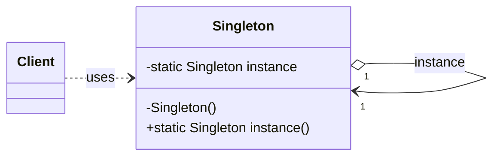

# Singleton Pattern

## Description

The **Singleton** pattern ensures that a class has **only one instance** and provides a **global
point of access** to it.  
It is useful when exactly one object is needed to coordinate actions across the system, e.g.,
logging, configuration manager, or thread pool.

---

## Key Features

- **Single Instance**: Only one instance of the class exists.
- **Global Access**: Provides a single point of access.
- **Lazy Initialization**: The instance is created on first use.
- **Thread-Safe (C++11+)**: Guaranteed thread-safe initialization with static local variable.

---

## Advantages

- Controlled access to the sole instance.
- Reduces namespace pollution (no global variables).
- Can be extended to provide flexible initialization (lazy, eager).

---

## Disadvantages

- Can introduce global state.
- Harder to unit test.
- Can be overused, leading to tight coupling.

## UML diagram

